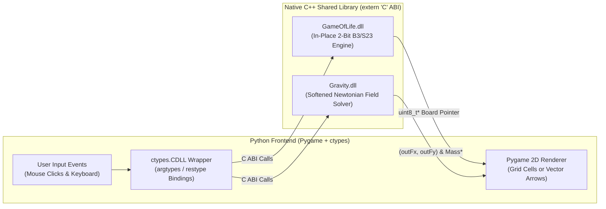

# Visualizations — Hybrid C++ & Python Interactive Simulations

[](https://isocpp.org/)
[](https://www.python.org/)
[](https://www.pygame.org/)
[](https://docs.python.org/3/library/ctypes.html)

A collection of real-time 2D scientific and mathematical visualizations built with a **hybrid C++17 / Python architecture**: performance-critical simulation logic is compiled into native shared libraries (`.dll`) with C-compatible `extern "C"` ABIs and driven interactively through Python's `ctypes` FFI and `Pygame`.

---

## Included Visualizations

### 1. Cellular Automata — Conway's Game of Life (`cellular-automata/`)

An interactive implementation of **Conway's Game of Life (B3/S23)** featuring a zero-allocation in-place generation stepper in C++17.

- **Ruleset & Boundaries**: Standard Moore neighborhood (8 neighbors) on a fixed-boundary `30×30` grid—live cells survive with 2 or 3 neighbors; dead cells become alive with exactly 3 neighbors.
- **In-Place 2-Bit State Packing (`GameOfLife.cpp`)**: Stores both the current generation (bit 0) and next generation (bit 1) inside a single flat `std::vector<uint8_t>` (`0b11` survive, `0b10` birth, `0b01` die, `0b00` remain dead), then commits the entire board in one right-shift pass (`cell >>= 1`) without allocating a double buffer.
- **Opaque-Handle C ABI (`GameOfLife.h`)**: Exposes `GameOfLife_create`, `GameOfLife_destroy`, `GameOfLife_setCell`, `GameOfLife_getCell`, `GameOfLife_step`, `GameOfLife_getBoard`, and `GameOfLife_getBoardSize`.
- **Interactive Canvas (`visualisation.py`)**: `600×600` Pygame window (`cell_size = 20`) running at 10 FPS; starts paused so you can draw custom patterns before stepping.

### 2. Gravitational Vector Field Visualizer (`gravity-visualization/`)

An interactive 2D **Newtonian gravitational field visualizer** that dynamically renders force vectors across a spatial grid as you add or remove point masses.

- **Softened Newtonian Superposition (`gravity.cpp`)**: Evaluates the net gravitational acceleration vector at every sample point `(x, y)` from all placed masses using Plummer-like softening (`softening = 5.0`), gravitational constant `G = 9.81`, and a near-singularity cutoff (`ESP = 4.0`, skipping contributions where `r² < 16.0`):

  $$\vec{F}(x, y) = \sum_{i} \frac{-G \, m_i \, (\vec{r} - \vec{r}_i)}{\left(\|\vec{r} - \vec{r}_i\|^2 + \varepsilon^2\right)^{3/2}}$$

- **C ABI (`gravity.h`)**: Exports `struct Mass { int x; int y; double mass; }` along with `addMass`, `removeMass`, `clearMasses`, `vectorDir`, `getMasses`, and `getMassesCount`.
- **Color-Mapped Vector Grid (`visualization.py`)**: `800×600` Pygame window at 60 FPS evaluating a `40px` vector grid (`ARROW_SCALE = 200`, clamped to `MAX_ARROW_LENGTH = 30`). Vector segments interpolate from **green (weak)** to **red (strong)** by magnitude with green tip dots, while point masses appear as yellow circles (`radius = sqrt(mass)`).

---

## Architecture

Both projects follow the same clean separation between native C++ computation and Python visualization:



---

## Tech Stack

| Layer | Technologies |
| :--- | :--- |
| **Compute Engines** | C++17 (`g++` / MinGW-w64), `extern "C"` shared DLLs |
| **FFI Bridge** | Python `ctypes` (`CDLL`, `Structure`, `POINTER`, `byref`) |
| **Visualization & Input** | Python 3, Pygame (`2.6.1`) |

---

## Project Structure

```text
Visualizations/
├── README.md
├── cellular-automata/
│   ├── GameOfLife.h          # GameOfLife class & extern "C" handle ABI
│   ├── GameOfLife.cpp        # 2-bit in-place B3/S23 simulation engine
│   ├── build.bat             # MinGW g++ C++17 DLL build script
│   ├── GameOfLife.dll        # Precompiled Windows shared library
│   └── visualisation.py      # Pygame interactive 30x30 grid frontend
└── gravity-visualization/
    ├── gravity.h             # Mass struct & extern "C" field solver ABI
    ├── gravity.cpp           # Softened Newtonian vector field superposition
    ├── Gravity.dll           # Precompiled Windows shared library
    ├── libwinpthread-1.dll   # Runtime dependency for MinGW-compiled DLL
    └── visualization.py      # Pygame 800x600 interactive vector field frontend
```

---

## Getting Started

### Prerequisites

- **Windows** (precompiled `.dll` binaries are included; on Linux/macOS, compile `.so`/`.dylib` and update the library filename in the Python scripts)
- **Python 3.10+** with `pygame` installed
- *(Optional, to rebuild C++ libraries)* **MinGW-w64 `g++`** with C++17 support

### Installing Pygame

```bash
pip install pygame
```

---

## Running Each Visualization

### Conway's Game of Life (`cellular-automata`)

```bash
cd cellular-automata

# (Optional) Rebuild GameOfLife.dll from C++ source
.\build.bat

# Run the visualization
python visualisation.py
```

**Controls:**

| Input | Action |
| :--- | :--- |
| **Mouse Click** | Toggle a cell between alive (white) and dead (dark gray) |
| **Spacebar** | Toggle Play / Pause (starts paused) |
| **Window Close** | Exit and release C++ engine handle |

---

### Gravitational Vector Field (`gravity-visualization`)

```bash
cd gravity-visualization

# (Optional) Rebuild Gravity.dll from C++ source
g++ -std=c++17 -shared -o Gravity.dll gravity.cpp -static-libgcc -static-libstdc++

# Run the visualization
python visualization.py
```

**Controls:**

| Input | Action |
| :--- | :--- |
| **Left Click** | Place a new point mass (`mass = 100.0`) at the cursor |
| **Right Click (on a mass)** | Remove the clicked point mass |
| **Window Close** | Exit the application |
